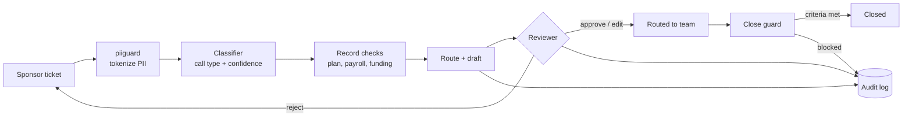

# SponsorDesk

**Human-approved AI triage for a retirement plan service desk.**

Employers who sponsor 401(k) and 403(b) plans send a steady stream of tickets: rejected payroll files, missing contributions, enrollment questions, loans, distributions. Each one means reading the ticket, finding the plan record and payroll files, choosing a team, and writing a reply, all while the text is full of SSNs and account numbers.

SponsorDesk does the groundwork and leaves every decision to a person:

1. **Redacts** PII into reversible tokens before any model sees the text.
2. **Classifies** the request into one of eight call types, with a confidence score.
3. **Checks the records:** plan rules, recent payroll files, funding status, and loan limits, to find the likely root cause.
4. **Routes and drafts:** recommends a team with a reason and writes a plain-language reply.
5. **Waits for a reviewer** to approve, edit, or reject. Nothing is sent automatically.
6. **Guards the close:** a code-level rule (not a prompt) refuses to close any ticket whose resolution criteria are not confirmed.
7. **Audits everything:** every proposal, decision, and blocked close is logged as structured JSON.



## Results on the held-out set

| Check | Result |
|---|---|
| Raw PII values reaching the model | **0 of 1,399** |
| Routing accuracy | **93%** |
| Unresolved tickets that could be closed | **0** (enforced by tests) |
| Call-type accuracy (TF-IDF + logistic regression) | 100%, an upper bound on templated tickets; harder paraphrased tickets are on the roadmap |

These numbers are recomputed when the app starts and shown in the console's quality report.

## Quick start

```bash
uv sync
uv run sponsordesk-console          # http://localhost:8000
```

Or with Docker:

```bash
docker compose up --build
```

Run the checks:

```bash
uv run pytest -q
uv run ruff check packages
```

Generate the dataset to disk:

```bash
uv run sponsordesk-synth generate --out data/generated --seed 42
```

## What's inside

| Package | Purpose |
|---|---|
| `packages/core` | Domain models (sponsors, plans, participants, loans, payroll files, tickets) and the routing policy |
| `packages/synth` | Deterministic data generator: 30 sponsors, 800+ participants, 236 payroll files with planted defects, and 500 labelled tickets |
| `packages/redact` | **piiguard**: policy-driven PII detection and reversible tokenization, published as its own package |
| `packages/console` | Triage engine, review API (FastAPI), close guard, audit log, and the reviewer UI |
| `deploy/ecs` | Idempotent deploy and teardown scripts for AWS ECS Fargate behind an ALB |

### Synthetic data you can trust

Every person, company, and identifier is fictional, and the generator uses ranges that cannot collide with real ones: SSNs in the never-issued 9xx area, EINs with the unassigned `00` prefix, phone numbers in 555-01xx, and email addresses on the reserved `.example` domain. Tests enforce all of this.

The tickets match the records. A ticket that says "our 9/15 file was rejected" points to a file that really contains the defect, and the labels record the exact root cause, team, and every PII value in the text. Same seed, same bytes.

### Policy-driven redaction

```yaml
destinations:
  llm:            { ssn: tokenize, account_number: tokenize, person_name: tokenize, ... }
  human_reviewer: { ssn: mask, account_number: mask, person_name: allow, ... }
```

The model sees `[PERSON_NAME_1] (SSN [SSN_1])`. The reviewer sees `Maria Lopez (SSN ***-**-5678)`. Tokens are restored only in replies a human has approved. A data class the policy doesn't list falls back to the most restrictive action.

## Roadmap

- [x] Synthetic data generator with ground truth
- [x] PII redaction library and destination policy
- [x] Review workflow, close guard, audit log, reviewer console
- [ ] Mock ticketing and plan API with OAuth 2.0 client credentials and read/write scopes
- [ ] MCP servers: `piiguard` redaction and service desk tools (`get_ticket`, `get_plan_record`, `get_payroll_files`, `propose_routing`, `update_ticket`)
- [ ] Claude agent with a triage skill (`SKILL.md`), replacing the rule-based context checks
- [ ] Classifier comparison: TF-IDF vs. fine-tuned transformer vs. Claude zero-shot, on harder tickets
- [ ] Full eval suite and Slack approval buttons
- [ ] HTTPS deployment, CloudWatch metrics, and runbook

## Guardrails

- A human approves every action. There are no autonomous replies.
- No financial or investment advice. Drafts detect advice requests and decline them.
- No real data. Everything is generated.
